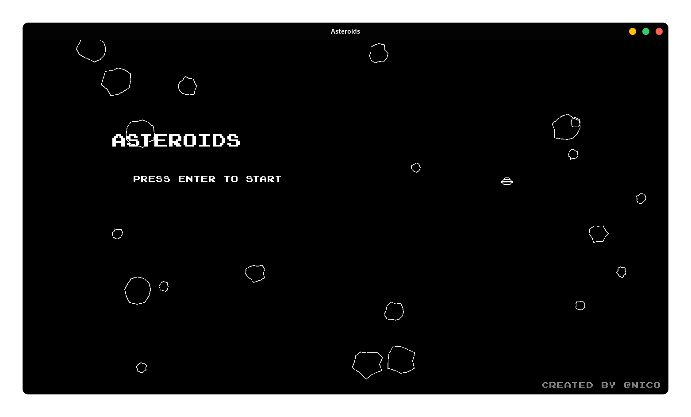
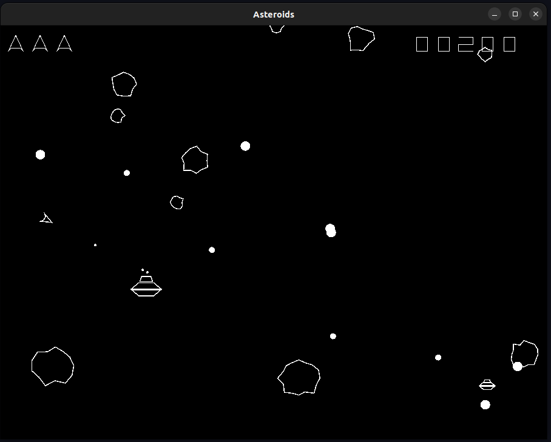
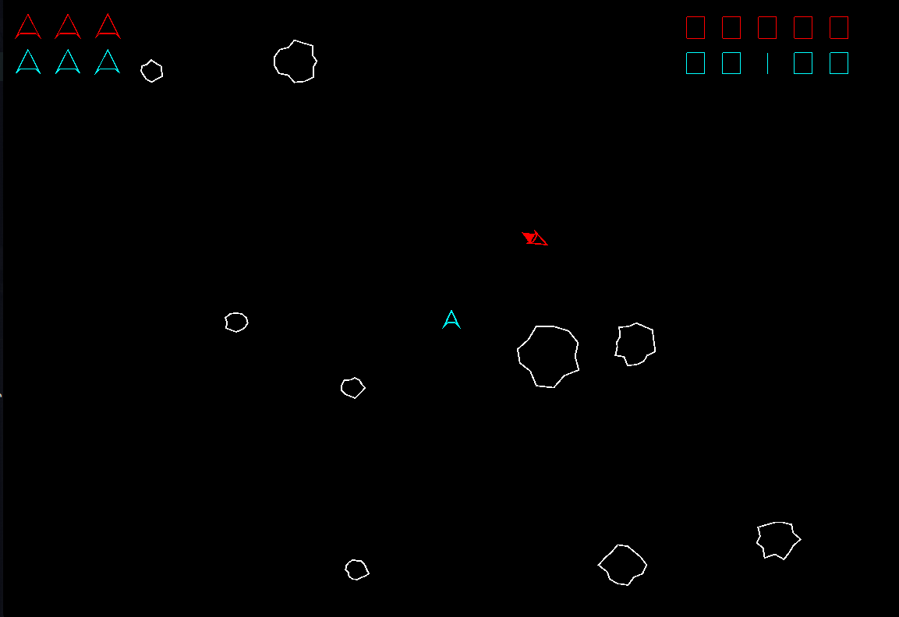

# Asteroids

My take on the classic arcade game, written in C++20 with SFML.
Dodge asteroids, fight alien ships and chase highscores alone or with a friend.

Linux is the currently supported release platform.



## Gameplay

Start with three lives and survive increasingly challenging waves.

- Waves last 30 seconds. Remaining enemies carry over into the next wave.
- Clear all enemies and scheduled spawns early to earn a bonus and start
  a five-second break before the next wave.
- Different wave types vary asteroid pressure and alien encounters.
- Large aliens fire three-shot fans; small aliens fire aimed shots.
- Earn extra lives at 3,000, 7,000 and 12,000 points, then every additional
  6,000 points. You can hold up to five lives.
- Temporary protection applies at the start and after respawning.
- Music responds to the current danger instead of resetting every wave.

A hit costs one life. In solo mode, the run ends when you run out of lives.
In cooperative mode, it ends when both players are out.



## Local Co-op

Two players share the same screen, with separate scores and lives.
Enemy arrivals increase while both players remain in the game.



## Profiles and Highscores

Create a profile or select an existing name before playing.
Solo and cooperative highscores are stored separately.

On Linux, scores are normally saved in:

```text
~/.local/share/asteroids/
```

If `XDG_DATA_HOME` is set to an absolute path, the game uses
`$XDG_DATA_HOME/asteroids/` instead.

Score storage includes backups and best-effort migration of older records.
If saving fails, the game displays a message.

## Controls

### Keyboard

| Action | Solo / Player 1 | Player 2 |
| --- | --- | --- |
| Thrust | W | Up arrow |
| Rotate left | A | Left arrow |
| Rotate right | D | Right arrow |
| Shoot | Space | Right Ctrl |

Each press fires one shot. Holding the fire button does not enable autofire.

| Action | Key |
| --- | --- |
| Continue from the start screen | Enter |
| Select solo / cooperative mode | 1 / 2 |
| Pause / resume | P |
| Toggle sound | M |
| Exit during gameplay | Esc |

The game pauses when its window loses focus.

### Controller

The current mapping targets PS4 controllers:

- Left stick: rotate.
- X: shoot.
- R2: thrust.

In cooperative mode, the first and second controllers control Player 1
and Player 2 respectively. Other controller mappings are not guaranteed.

### Profile Selection

- Arrow keys: navigate profiles.
- Type a name to create a profile.
- Enter: confirm.
- Delete: remove the selected profile and its saved scores.

## Download

Available builds and installation instructions are listed on the
[GitHub Releases page](https://github.com/vnic03/Asteroids/releases).

Use the dependency instructions for the selected release.
Windows and macOS support is not yet verified for version 1.1.

## Build from Source

Requirements:

- A C++20-compatible compiler.
- CMake 3.22.1 or newer.
- SFML 2.6.x with graphics, window, system and audio components.

```bash
git clone https://github.com/vnic03/Asteroids
cd Asteroids

cmake -S . -B build -DCMAKE_BUILD_TYPE=Release
cmake --build build -j2

./build/Asteroids
```

Alternatively, the Linux helper script builds and starts the game:

```bash
./run.sh
```

CMake copies the required assets into the build directory.

## Configuration

The game supports these environment variables:

| Variable | Purpose |
| --- | --- |
| `ASTEROIDS_ASSET_DIR` | Custom asset directory |
| `ASTEROIDS_FONT` | Custom font file |
| `ASTEROIDS_DATA_DIR` | Custom score storage directory |
| `ASTEROIDS_LEGACY_DIR` | Directory containing legacy score files |

Master, music and effects volumes can currently be adjusted in
`src/music/AudioSettings.h`. There is no in-game volume settings menu yet.

## Development

C++ formatting is configured through `.clang-format`.
The project currently uses clang-format 18 with an 80-column limit.

```bash
find src -type f \( -name '*.cpp' -o -name '*.h' \) \
    -exec clang-format -i {} +
```

See [CHANGELOG.md](CHANGELOG.md) for release changes and
[LICENSE](LICENSE) for licensing information.

This is my first C++ project, built to learn the language.
Thanks for playing!
